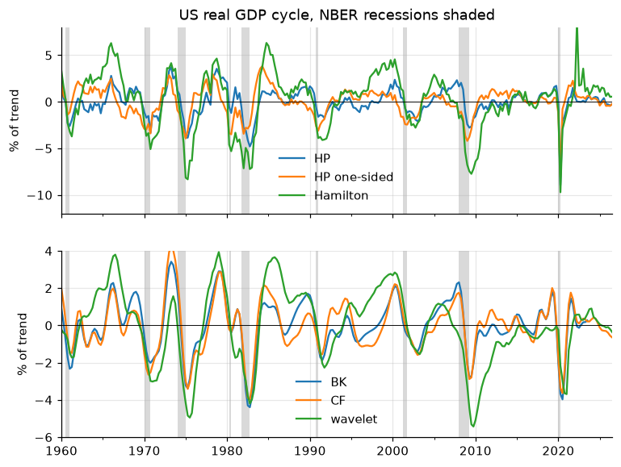

# Economic Time Series in Python

[](https://github.com/hmorao95/econ-time-series-manual/actions/workflows/ci.yml)

<div align="center">
📚 <a href="https://hmorao95.github.io/econ-time-series-manual">Read it as a book</a>
</div>
<br>

A practical handbook for economists who manipulate time series in Python:
dates and frequencies, growth rates, aggregation, interpolation and temporal
disaggregation, seasonal adjustment, detrending, business-cycle dating,
crisis dummies and paper-quality figures. Each chapter is a notebook that
runs as written on real data, ending with a summary and exercises. Every
recipe is also packaged in **`econts`**, a toolkit you can import in your
own projects.



## 📑 Content

1. **Dates, periods and frequencies**
   - `Period` vs `Timestamp`, frequency aliases
   - Making gaps visible, business days and holidays
   - Fiscal years
   - Merging sources with different date conventions

   [](https://nbviewer.jupyter.org/github/hmorao95/econ-time-series-manual/blob/main/notebooks/01/dates-frequencies.ipynb) or [](https://colab.research.google.com/github/hmorao95/econ-time-series-manual/blob/main/notebooks/01/dates-frequencies.ipynb)

2. **Transformations**
   - Growth rates: q/q, SAAR, y/y, Q4/Q4, log differences
   - Carry-over, rebasing, deflating, splicing
   - Demeaning (by regime, month, panel unit) and scaling

   [](https://nbviewer.jupyter.org/github/hmorao95/econ-time-series-manual/blob/main/notebooks/02/transformations.ipynb) or [](https://colab.research.google.com/github/hmorao95/econ-time-series-manual/blob/main/notebooks/02/transformations.ipynb)

3. **Temporal aggregation**
   - Flows, stocks, rates and SAAR flows
   - Incomplete periods
   - Weekly to monthly, fiscal years

   [](https://nbviewer.jupyter.org/github/hmorao95/econ-time-series-manual/blob/main/notebooks/03/aggregation.ipynb) or [](https://colab.research.google.com/github/hmorao95/econ-time-series-manual/blob/main/notebooks/03/aggregation.ipynb)

4. **Interpolation and temporal disaggregation**
   - Filling gaps, Kalman smoother
   - Denton, Chow-Lin and Fernandez
   - Nowcasting a held-out quarter

   [](https://nbviewer.jupyter.org/github/hmorao95/econ-time-series-manual/blob/main/notebooks/04/interpolation.ipynb) or [](https://colab.research.google.com/github/hmorao95/econ-time-series-manual/blob/main/notebooks/04/interpolation.ipynb)

5. **Seasonal adjustment**
   - Testing for seasonality
   - Classical decomposition, STL, MSTL
   - Trading-day and Easter effects, X-13ARIMA-SEATS

   [](https://nbviewer.jupyter.org/github/hmorao95/econ-time-series-manual/blob/main/notebooks/05/seasonal-adjustment.ipynb) or [](https://colab.research.google.com/github/hmorao95/econ-time-series-manual/blob/main/notebooks/05/seasonal-adjustment.ipynb)

6. **Detrending and filtering**
   - Polynomial trends with breaks, HP (two- and one-sided)
   - Hamilton, Baxter-King, Christiano-Fitzgerald
   - Beveridge-Nelson (uni- and bivariate), Blanchard-Quah, Haar wavelets, UC models

   [](https://nbviewer.jupyter.org/github/hmorao95/econ-time-series-manual/blob/main/notebooks/06/detrending.ipynb) or [](https://colab.research.google.com/github/hmorao95/econ-time-series-manual/blob/main/notebooks/06/detrending.ipynb)

7. **Rolling windows, smoothing, lags and leads**
   - Trailing vs centered averages, EWMA, 3m/3m
   - Rolling volatility, correlations and regressions
   - Expanding windows, lags and leads

   [](https://nbviewer.jupyter.org/github/hmorao95/econ-time-series-manual/blob/main/notebooks/07/rolling-smoothing.ipynb) or [](https://colab.research.google.com/github/hmorao95/econ-time-series-manual/blob/main/notebooks/07/rolling-smoothing.ipynb)

8. **Business cycles**
   - BBQ turning points, phase statistics
   - Stylized facts of the cycle
   - Robust skewness and kurtosis, a principal-component coincident index

   [](https://nbviewer.jupyter.org/github/hmorao95/econ-time-series-manual/blob/main/notebooks/08/business-cycles.ipynb) or [](https://colab.research.google.com/github/hmorao95/econ-time-series-manual/blob/main/notebooks/08/business-cycles.ipynb)

9. **Diagnostics**
   - ADF and KPSS together, Zivot-Andrews
   - ACF, PACF, Ljung-Box
   - Outliers: robust z-scores, dummies, winsorizing

   [](https://nbviewer.jupyter.org/github/hmorao95/econ-time-series-manual/blob/main/notebooks/09/diagnostics.ipynb) or [](https://colab.research.google.com/github/hmorao95/econ-time-series-manual/blob/main/notebooks/09/diagnostics.ipynb)

10. **Crisis dummies and recession bands (Portugal)**
   - Recession chronologies, episodes, grey and hatched bands
   - Episode and slope dummies, event studies
   - Pulse/step/ramp dummies, Markov-switching recession probabilities

   [](https://nbviewer.jupyter.org/github/hmorao95/econ-time-series-manual/blob/main/notebooks/10/crisis-dummies.ipynb) or [](https://colab.research.google.com/github/hmorao95/econ-time-series-manual/blob/main/notebooks/10/crisis-dummies.ipynb)

11. **Paper-quality figures**
   - SVAR impulse responses with bands
   - Specification comparisons, shaded time series
   - Historical decompositions, with housestyle

   [](https://nbviewer.jupyter.org/github/hmorao95/econ-time-series-manual/blob/main/notebooks/11/paper-figures.ipynb) or [](https://colab.research.google.com/github/hmorao95/econ-time-series-manual/blob/main/notebooks/11/paper-figures.ipynb)

Reference: [the `econts` toolkit](notebooks/00/toolkit.md) ·
[cheat sheet](notebooks/00/cheatsheet.md) ·
[knowledge test](notebooks/00/knowledge_test.md) ·
[resources](notebooks/00/resources.md)

## 🧰 The `econts` toolkit

```bash
pip install git+https://github.com/hmorao95/econ-time-series-manual
```

```python
import numpy as np
from econts import load
from econts.filters import hamilton_filter, bn_bq_bivariate
from econts.disagg import denton, chow_lin
from econts.cycles import bbq
from econts.dummies import episodes, shade

y = 100 * np.log(load("GDPC1"))               # bundled FRED snapshot
cycle, trend = hamilton_filter(y)
turning_points = bbq(y)
```

Modules: `transform`, `aggregate`, `disagg`, `seasonal`, `filters`,
`cycles`, `dummies`, `diagnostics`, `svar`. The
[toolkit page](notebooks/00/toolkit.md) lists every function and the chapter
that explains it. `load(series_id, online=True)` fetches any FRED series.

### Command line

Installing the toolkit also installs an `econts` command (python-fire), for
shell scripts or Stata/MATLAB pipelines. A source is a CSV file (first column
dates) or a FRED id; results print, or go to a CSV with `--out`:

```bash
econts series                                            # bundled FRED ids
econts load GDPC1 --out gdp.csv
econts growth CPIAUCSL --kind yoy
econts aggregate PAYEMS --freq QS --how mean
econts filter gdp.csv --log --method hamilton --out cycle.csv
econts disagg GDPC1 --indicators INDPRO,PAYEMS --method chow-lin --out gdp_m.csv
econts seasonal RSXFSN --calendar --out sales_sa.csv
econts bbq GDPC1 --log
econts unitroot UNRATE
econts outliers ICSA --log
```

`econts <command> --help` lists every flag. Filter methods: `hp`, `hp1`
(one-sided HP), `hamilton`, `bk`, `cf`, `bn`, `poly`, `haar`. Expected errors
(a missing file, an unknown method) print one line and exit with code 1.

## 🚀 Running the notebooks

Open any chapter in Colab with the buttons above (the first cell installs the
toolkit), or locally:

```bash
git clone https://github.com/hmorao95/econ-time-series-manual
cd econ-time-series-manual
uv sync                                  # or: pip install -e ".[book]" jupyterlab
uv run --with jupyterlab jupyter lab notebooks
```

## ⚒ Development

```bash
uv run pytest                                      # toolkit tests + every notebook
uv run python scripts/execute_notebooks.py         # re-run notebooks, save outputs
uv run jupyter-book build .                        # build the book into _build/html
uv run python scripts/fetch_data.py                # refresh the FRED snapshot
```

Notebooks are stored with their outputs. Refreshing the data can change
numbers quoted in the text (FRED revises history): re-run the notebooks and
reread the quoted figures afterwards.

## Credits

The structure follows Filippo Maria Bianchi's
[Time series analysis with Python](https://github.com/FilippoMB/python-time-series-handbook).
Several recipes port functions of Filippo Ferroni's
[Empirical Macro Toolbox](https://naffe15.github.io/EMT/) (MATLAB); chapter 11
uses [housestyle](https://github.com/hmorao95/housestyle). Data: FRED,
Federal Reserve Bank of St. Louis (series from BEA, BLS, Census, the Federal
Reserve Board, DOL, EIA, Eurostat and the OECD).

## License

MIT.
