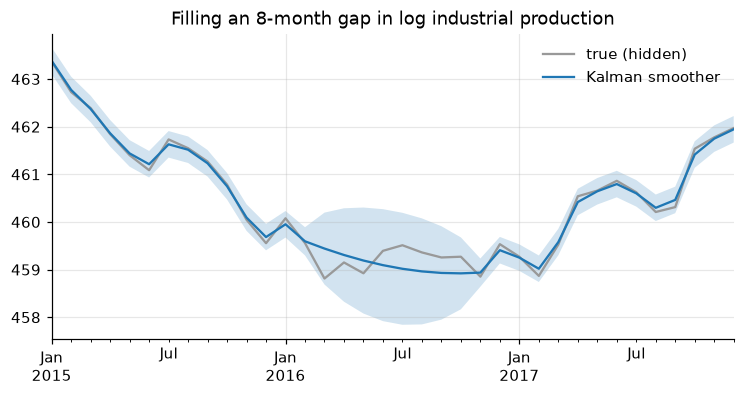
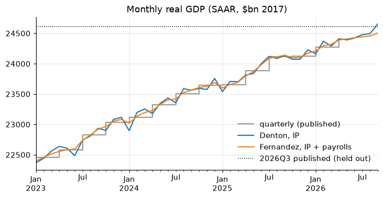

# 4. Interpolation and temporal disaggregation

Two different problems share the word "interpolation":

1. **Filling gaps** in a series observed at its own frequency (a missing
   month, market holidays).
2. **Temporal disaggregation**: building a monthly series from a quarterly
   one (or quarterly from annual) so that the high-frequency series **adds up**
   to the low-frequency one.

!!! tip "Quick rules"
    * Short gaps in a smooth series: `interpolate(method="time")`.
    * Gaps in a series that moves with others: a state-space model (Kalman
      smoother) or a regression on related series.
    * Low → high frequency: never plain `interpolate`, it breaks the
      aggregation constraint. Use **Denton** (no or one indicator) or
      **Chow-Lin** (one or more indicators, estimated by GLS).

```python
import numpy as np
import pandas as pd
import matplotlib.pyplot as plt
import statsmodels.api as sm
from tsmanual import load

brent = load("DCOILBRENTEU")
ip = load("INDPRO")
gdp = load("GDPC1")
```

## Filling gaps

```python
s = brent["2024-12-20":"2025-01-03"]
fills = pd.DataFrame(
    {
        "raw": s,
        "ffill": s.ffill(),  # last price carried forward
        "linear": s.interpolate(),  # equal steps per row
        "time": s.interpolate(method="time"),  # steps proportional to time
        "pchip": s.interpolate(method="pchip"),  # shape-preserving cubic
    }
)
print(fills.round(2))
```

* `linear` ignores the index, `time` respects uneven spacing. They only
  differ when rows are unevenly spaced in time.
* `pchip` and `akima` are smooth without overshooting; `spline` (order 3) can
  overshoot near sharp moves.
* `limit=2` caps how many consecutive `NaN` are filled; `limit_area="inside"`
  refuses to extrapolate at the ends.

For prices, `ffill` is the market convention (the last traded price is the
price). For flows and smooth economic series, interpolate.

## Gaps filled by a Kalman smoother

A state-space model handles `NaN` natively: the Kalman filter skips the
update step and the smoother fills the gap with the model-consistent path,
along with an uncertainty band. A local linear trend on log IP:

```python
y = 100 * np.log(ip["2010":"2019"]).asfreq("MS")
y_gap = y.copy()
y_gap["2016-03":"2016-10"] = np.nan  # knock out eight months

mod = sm.tsa.UnobservedComponents(y_gap, level="local linear trend")
res = mod.fit(disp=False)
smoothed = pd.Series(res.level.smoothed, index=y.index)
band = 1.96 * np.sqrt(res.level.smoothed_cov)

gap = y_gap.isna()
print(
    "RMSE in the gap: kalman",
    np.sqrt(((smoothed - y)[gap] ** 2).mean()).round(3),
    "| linear",
    np.sqrt(((y_gap.interpolate() - y)[gap] ** 2).mean()).round(3),
)

ax = y["2015":"2017"].plot(color="0.6", label="true (hidden)")
smoothed["2015":"2017"].plot(ax=ax, label="Kalman smoother")
ax.fill_between(
    y["2015":"2017"].index,
    (smoothed - band)["2015":"2017"],
    (smoothed + band)["2015":"2017"],
    alpha=0.2,
)
ax.set_title("Filling an 8-month gap in log industrial production")
ax.legend()
# figure: kalman_gap
```



The smoother is no more accurate than a straight line here: a univariate
trend model can only draw a smooth path through the gap. What it adds is the
**uncertainty band**. Accuracy gains come from adding **related series**: a dynamic factor model or a
regression with ARMA errors (`sm.tsa.SARIMAX(y, exog=X)`) uses the other
series' movements during the gap.

## Temporal disaggregation

The target: a monthly series $x$ whose quarterly aggregate equals the
published quarterly series $Y$, i.e. $C x = Y$. For a quarterly average
$C = I_n \otimes [\tfrac13\ \tfrac13\ \tfrac13]$; for a sum, drop the $\tfrac13$.

First, why plain interpolation is wrong:

```python
gdp_q = gdp["2015":"2019"]
naive = gdp_q.resample("MS").interpolate()  # linear through quarter starts
back = naive.resample("QS").mean()
print((back / gdp_q - 1).dropna().abs().max())  # does not add up
```

### Denton (proportional first difference)

Denton–Cholette keeps the **ratio** of the target to an indicator $i_t$ as
smooth as possible while meeting the constraint:

$$\min_x \sum_t \left(\frac{x_t}{i_t} - \frac{x_{t-1}}{i_{t-1}}\right)^2
\quad \text{s.t.} \quad C x = Y .$$

With a constant indicator, it is a smooth interpolation that adds up. It is
a quadratic program with a closed-form solution:

```python
def agg_matrix(n_low: int, n_high: int, m: int = 3, how: str = "mean") -> np.ndarray:
    """C such that C @ x aggregates consecutive blocks of m high-freq values."""
    C = np.kron(np.eye(n_low), np.ones((1, m)))
    C = np.hstack([C, np.zeros((n_low, n_high - m * n_low))])  # months beyond
    return C / m if how == "mean" else C


def denton(
    Y: pd.Series, indicator: pd.Series, m: int = 3, how: str = "mean"
) -> pd.Series:
    """Proportional Denton benchmarking of `indicator` to the low-frequency `Y`.

    `indicator` must start in the first sub-period of `Y`'s first period. It may
    run past `Y`'s last period; those months are extrapolated with the indicator.
    """
    i = indicator.to_numpy(float)
    T, n = len(i), len(Y)
    C = agg_matrix(n, T, m, how)
    D = np.diff(np.eye(T), axis=0)  # first-difference operator
    A = C * i  # constraint in terms of r = x / i
    K = np.block([[D.T @ D, A.T], [A, np.zeros((n, n))]])
    rhs = np.concatenate([np.zeros(T), Y.to_numpy(float)])
    r = np.linalg.solve(K, rhs)[:T]
    return pd.Series(r * i, index=indicator.index, name=Y.name)


months = pd.date_range("2015-01-01", "2019-12-01", freq="MS")
smooth = denton(gdp_q, pd.Series(1.0, index=months))
print((smooth.resample("QS").mean() / gdp_q - 1).abs().max())  # ~1e-16: adds up
```

With an indicator, monthly GDP inherits the indicator's monthly profile.
When the indicator runs past the last published quarter, Denton also
**extrapolates**. To see how well, hold out the latest quarter (2026Q3)
and benchmark industrial production to GDP up to 2026Q2:

```python
Y = gdp["2010":"2026-04"]  # published GDP up to 2026Q2
target = gdp["2026-07-01"]  # held out: 2026Q3
gdp_m_denton = denton(Y, ip["2010":"2026-09"])
print(gdp_m_denton.tail(6).round(0))  # Jul-Sep 2026 are extrapolated
```

### Chow–Lin and Fernández (regression-based)

Chow and Lin (1971) assume the monthly target follows a regression on
indicators, $x = X\beta + u$, with AR(1) errors $u_t = \rho u_{t-1} +
\varepsilon_t$. Only $Y = C x$ is observed, so $\beta$ is estimated by GLS
on the aggregated model, $\rho$ by maximum likelihood, and the quarterly
residuals are distributed across months. Fernández (1981) is the limit
$\rho = 1$, random-walk errors, for when target and indicators do not
cointegrate. Both are standard at Eurostat and national statistical offices.

```python
from scipy.optimize import minimize_scalar


def regression_disagg(
    Y: pd.Series,
    X: pd.DataFrame,
    method: str = "chow-lin",
    m: int = 3,
    how: str = "mean",
):
    """Chow-Lin (AR(1) errors) or Fernandez (random-walk errors) disaggregation.

    Returns the high-frequency series and a dict with beta and rho.
    """
    Xh = sm.add_constant(X).to_numpy(float)
    T, n = len(Xh), len(Y)
    C = agg_matrix(n, T, m, how)
    y, Xl = Y.to_numpy(float), C @ Xh
    t = np.arange(T)

    def gls(rho):
        if method == "fernandez":
            S = np.minimum.outer(t, t) + 1.0  # random walk from 0
        else:
            S = rho ** np.abs(np.subtract.outer(t, t)) / (1 - rho**2)
        V = C @ S @ C.T
        Vi = np.linalg.inv(V)
        beta = np.linalg.solve(Xl.T @ Vi @ Xl, Xl.T @ Vi @ y)
        e = y - Xl @ beta
        loglik = -0.5 * (n * np.log(e @ Vi @ e / n) + np.linalg.slogdet(V)[1])
        return beta, e, S, Vi, loglik

    rho = 1.0
    if method == "chow-lin":
        rho = minimize_scalar(
            lambda r: -gls(r)[-1], bounds=(0.0, 0.99), method="bounded"
        ).x
    beta, e, S, Vi, _ = gls(rho)
    x = Xh @ beta + S @ C.T @ Vi @ e  # regression + distributed residual
    return pd.Series(x, index=X.index, name=Y.name), {"beta": beta, "rho": rho}


X = pd.DataFrame({"ip": ip, "payems": load("PAYEMS")})["2010":"2026-09"]
gdp_m_cl, info = regression_disagg(Y, X, "chow-lin")
gdp_m_fe, _ = regression_disagg(Y, X, "fernandez")
print("Chow-Lin rho =", round(info["rho"], 3))
print((gdp_m_fe[: 3 * len(Y)].resample("QS").mean() / Y - 1).abs().max())  # adds up
```

The Chow–Lin $\hat\rho$ sits at the upper bound: the regression residual
is close to a random walk, which is the case Fernández is built for. How do
the methods do on the held-out quarter?

```python
nowcast = pd.Series(
    {
        "no change (2026Q2 level)": Y.iloc[-1],
        "Denton, IP": gdp_m_denton["2026-07":].mean(),
        "Chow-Lin, IP + payrolls": gdp_m_cl["2026-07":].mean(),
        "Fernandez, IP + payrolls": gdp_m_fe["2026-07":].mean(),
    }
)
print((100 * (nowcast / target - 1)).round(2).rename("error vs published 2026Q3, %"))
```

All three indicator methods beat "no change" on this quarter, and Denton
wins it. One quarter proves little: before choosing a method for production
work, repeat the exercise over many held-out quarters.

```python
fig, ax = plt.subplots()
window = slice("2023-01", None)
Y[window].resample("MS").ffill().plot(
    ax=ax, color="0.6", drawstyle="steps-post", label="quarterly (published)"
)
gdp_m_denton[window].plot(ax=ax, label="Denton, IP")
gdp_m_fe[window].plot(ax=ax, label="Fernandez, IP + payrolls")
ax.axhline(target, color="k", ls=":", lw=1, label="2026Q3 published (held out)")
ax.set_title("Monthly real GDP (SAAR, $bn 2017)")
ax.legend()
# figure: disaggregation
```



**Choosing**: Denton when you trust the indicator's *profile* and only need
it benchmarked; Chow–Lin when target and indicators cointegrate (residual
stationary, $\hat\rho$ well inside the unit interval); Fernández or Litterman
when $\hat\rho$ runs to 1. R's `tempdisagg` package implements all of them and
is the reference to check against.

## Pitfalls

* Disaggregate **levels**, not growth rates, and choose sum vs mean to match
  the series (chapter 3).
* Interpolated or disaggregated values are estimates. Using them as data in
  a regression understates standard errors.
* Seasonally adjusted low-frequency data with an NSA indicator (or the other
  way round) produces spurious seasonal patterns in the result.
