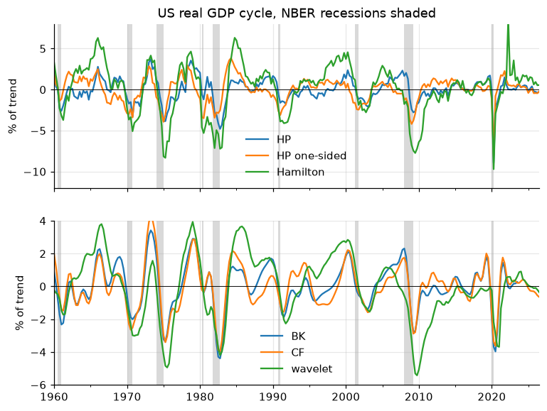
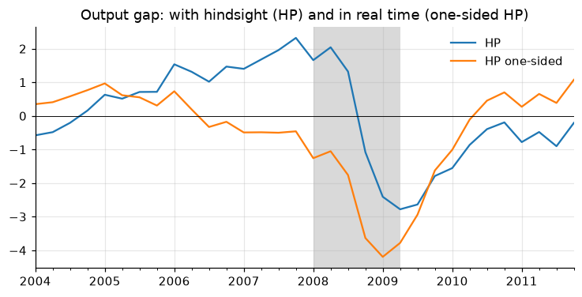

# 6. Detrending and filtering: trend and cycle

Splitting a series into a slow-moving **trend** and a **cycle** is the
first step of most business-cycle work (output gaps, credit gaps, stylized
facts). There is no unique right answer: every filter embeds a definition of
"trend", and the cycles they produce can differ a lot, especially at the end
of the sample, which is usually the part you care about.

!!! tip "Quick rules"
    * Detrend **logs × 100**: the cycle is then in percent of trend.
    * The two-sided HP filter is fine for describing history; it is **not**
      fine in real time. Use the one-sided HP or the Hamilton filter for
      anything that pretends to be known at time $t$.
    * Band-pass filters (BK, CF) let you choose the periodicities: 6–32
      quarters is the standard business-cycle band.
    * Report results for more than one filter.

Several recipes below are Python ports of functions in Filippo Ferroni's
[Empirical Macro Toolbox](https://naffe15.github.io/EMT/) (MATLAB):
`polydet`, `polydet_break`, `one_sided_hpfilter_serial`, `hamfilter`,
`BNuniv`, `wavefilter` and `shade`.

```python
import numpy as np
import pandas as pd
import matplotlib.pyplot as plt
import statsmodels.api as sm
from tsmanual import load

y = 100 * np.log(load("GDPC1")).asfreq("QS")  # log real GDP x 100
rec = load("USRECQ").asfreq("QS").reindex(y.index)


def shade_recessions(ax, rec=rec):
    """Shade NBER recession quarters (EMT's `shade`; chapter 10 generalizes it)."""
    on = rec.fillna(0).astype(bool)
    starts = on.index[on & ~on.shift(1, fill_value=False)]
    ends = on.index[on & ~on.shift(-1, fill_value=False)]
    for s, e in zip(starts, ends):
        ax.axvspan(s, e + pd.offsets.QuarterEnd(0), color="0.85", lw=0, zorder=0)
```

## Deterministic trends

Fit a polynomial in time; the residual is the cycle. A **break** lets the
trend change level and slope at a known date (e.g. a productivity slowdown).

```python
def poly_detrend(y: pd.Series, order: int = 1, break_at=None):
    """Polynomial trend, optionally a separate polynomial after `break_at`."""
    t = np.arange(len(y), dtype=float)
    X = np.vander(t, order + 1)
    if break_at is not None:
        after = (y.index >= pd.Timestamp(break_at)).astype(float)[:, None]
        X = np.hstack([X * (1 - after), X * after])
    beta, *_ = np.linalg.lstsq(X, y.to_numpy(), rcond=None)
    trend = pd.Series(X @ beta, index=y.index)
    return y - trend, trend


cyc_lin, _ = poly_detrend(y, order=1)
cyc_quad, _ = poly_detrend(y, order=2)
cyc_brk, _ = poly_detrend(y, order=1, break_at="1973-10-01")
```

Deterministic trends assume the trend never moves after a shock. If GDP has
a unit root, the "cycle" inherits it and wanders for decades.

## First differences

The growth rate is a valid stationary transformation, but it is not a cycle
in levels: it peaks in the middle of a recovery, not at the top of the boom.

```python
growth = y.diff()
```

## Hodrick–Prescott filter

HP picks the trend $\tau$ that minimizes
$\sum_t (y_t-\tau_t)^2 + \lambda \sum_t (\Delta^2 \tau_t)^2$.

| Frequency | $\lambda$ (Ravn–Uhlig, 2002) |
|---|---|
| Annual | 6.25 (100 is the older convention) |
| Quarterly | 1600 |
| Monthly | 129600 (14400 is the older convention) |
| Basel III credit-to-GDP gap (quarterly) | 400000, one-sided |

```python
cyc_hp, trend_hp = sm.tsa.filters.hpfilter(y, lamb=1600)
```

### One-sided HP

The two-sided filter uses future data. At the end of the sample, the trend
is pulled towards the last observations and the gap shrinks toward zero.
The one-sided version re-runs HP on each expanding sample and keeps only the
last point, so every value uses only data up to that date
(EMT `one_sided_hpfilter_serial`, by Alexander Meyer-Gohde).

```python
def hp_one_sided(y: pd.Series, lamb: float = 1600, min_obs: int = 12):
    """One-sided HP: the trend at t is the end point of HP on y[:t+1]."""
    trend = pd.Series(np.nan, index=y.index)
    for t in range(min_obs, len(y) + 1):
        trend.iloc[t - 1] = sm.tsa.filters.hpfilter(y.iloc[:t], lamb=lamb)[1].iloc[-1]
    return y - trend, trend


cyc_hp1, _ = hp_one_sided(y)
```

The one-sided trend is the Kalman-filter estimate of the HP state-space
model (Stock and Watson, 1999; see the UC section below), which is how the
Basel credit-to-GDP gap is computed in practice.

## Hamilton (2018) regression filter

Hamilton argues HP creates spurious dynamics and proposes a regression: the
cycle is the error of forecasting $y_{t+h}$ from its values at $t, t-1,
\dots, t-p+1$. For quarterly data, $h = 8$ (two years) and $p = 4$
(EMT `hamfilter`).

```python
def hamilton_filter(y: pd.Series, h: int = 8, p: int = 4):
    """Cycle = residual of y_t on a constant and y_{t-h}, ..., y_{t-h-p+1}."""
    X = pd.concat({f"y(t-{h + j})": y.shift(h + j) for j in range(p)}, axis=1)
    d = pd.concat([y.rename("y"), X], axis=1).dropna()
    fit = sm.OLS(d["y"], sm.add_constant(d.drop(columns="y"))).fit()
    return fit.resid.reindex(y.index), fit.fittedvalues.reindex(y.index)


cyc_ham, _ = hamilton_filter(y)
cyc_rw8 = y - y.shift(8)  # Hamilton's "random walk" special case
```

The first $h+p-1$ observations are lost. Use $h = 24$ for monthly data
and $h = 2$ for annual.

## Band-pass filters: Baxter–King and Christiano–Fitzgerald

Band-pass filters keep cycles with periods between `low` and `high`
(6 and 32 quarters, after Burns and Mitchell). Baxter–King (BK) is a
symmetric moving average and loses `K` observations at each end;
Christiano–Fitzgerald (CF) is asymmetric and uses the whole sample.

```python
cyc_bk = sm.tsa.filters.bkfilter(y, low=6, high=32, K=12)  # loses 12 + 12 obs
cyc_cf, _ = sm.tsa.filters.cffilter(y, low=6, high=32, drift=True)
```

## Beveridge–Nelson decomposition

The BN trend is the long-run forecast of the series, net of drift:
$\tau_t = y_t + \sum_{h\ge1} E_t[\Delta y_{t+h} - \mu]$. With an AR($p$) for
$\Delta y$ in companion form $X_t = F X_{t-1} + e_t$, the cycle is
$c_t = -e_1' F (I-F)^{-1} X_t$ (EMT `BNuniv`).

```python
def beveridge_nelson(y: pd.Series, p: int = 4):
    """Univariate BN decomposition with an AR(p) for the first difference."""
    dy = y.diff().dropna()
    x = dy - dy.mean()
    phi = sm.tsa.AutoReg(x, lags=p, trend="n").fit().params.to_numpy()
    F = np.zeros((p, p))
    F[0] = phi
    F[1:, :-1] = np.eye(p - 1)
    X = pd.concat([x.shift(j) for j in range(p)], axis=1)  # [x_t, ..., x_{t-p+1}]
    long_run = F @ np.linalg.inv(np.eye(p) - F)
    cycle = -(X @ long_run[0]).where(X.notna().all(axis=1))
    return cycle.reindex(y.index), (y - cycle)


cyc_bn, _ = beveridge_nelson(y)
```

The BN cycle of US GDP from a low-order AR is small and noisy: positive
growth shocks raise the trend more than one for one. Kamber, Morley and Wong
(2018) fix this by imposing a low signal-to-noise ratio (the "BN filter").

## Haar wavelet filter

Lubik, Matthes and Verona (2019) split a series with the Haar wavelet into
components $D_j$ with periods between $2^j$ and $2^{j+1}$ quarters. Each
component is the difference between two adjacent moving averages of length
$2^{j-1}$, so the filter is **one-sided** (EMT `wavefilter`).

```python
def haar_components(y: pd.Series, levels: int = 5) -> pd.DataFrame:
    """Haar wavelet details D1..D_levels; D_j has periods 2^j to 2^(j+1)."""
    out = {}
    for j in range(1, levels + 1):
        w = 2 ** (j - 1)
        m = y.rolling(w).mean()
        out[f"D{j}"] = (m - m.shift(w)) / 2
    return pd.DataFrame(out)


D = haar_components(cyc_brk)  # on the linearly detrended series
cyc_wav = D["D3"] + D["D4"]  # 8-32 quarter business cycle
trend_wav = y - D[["D1", "D2", "D3", "D4"]].sum(axis=1)
```

Remove the drift first. On a trending series each detail picks up the
growth rate: a linear trend with slope $g$ adds $g\,2^{j-2}$ to $D_j$, about
4.5 pp to $D_3 + D_4$ for US GDP. Applying the filter to the series minus a
(broken) linear trend removes this; the details of a linear trend are zero.

## Unobserved components models

A UC model writes the series as a sum of unobserved trend and cycle
processes and estimates them with the Kalman filter. HP is a special case:
an integrated random-walk ("smooth") trend plus a white-noise cycle, with
the variance ratio **fixed** at $1/\lambda$. The Kalman *smoother* gives the
two-sided HP trend and the Kalman *filter* gives the one-sided one:

```python
hp_uc = sm.tsa.UnobservedComponents(y, level="smooth trend")
hp_res = hp_uc.smooth([1.0, 1 / 1600])  # sigma2.irregular, sigma2.trend
print("smoother vs HP:", (hp_res.level.smoothed - trend_hp).abs().max().round(4))
print(
    "filter vs one-sided HP:",
    (y - hp_res.level.filtered - cyc_hp1).iloc[20:].abs().max().round(4),
)
```

The point of a UC model is to *estimate* the variances instead of fixing
them, e.g. Clark's (1987) local linear trend plus an AR(2) cycle (EMT `uc1_`
is a Bayesian version). On US GDP alone this runs into the **pile-up
problem**: maximum likelihood sets the trend variances to zero, and the
"trend" collapses to a straight line.

```python
clark = sm.tsa.UnobservedComponents(
    y[:"2019"], level="local linear trend", autoregressive=2
).fit(disp=False, maxiter=1000)
print(clark.params.round(3))  # sigma2.level and sigma2.trend ~ 0
```

Univariate UC decompositions of GDP are weakly identified. Add information
(Clark, 1989, adds unemployment through Okun's law; Phillips-curve models add
inflation), use priors (Bayesian UC), or fix the signal-to-noise ratio as HP
does.

## Comparing the cycles

```python
cycles = pd.DataFrame(
    {
        "linear+break": cyc_brk,
        "HP": cyc_hp,
        "HP one-sided": cyc_hp1,
        "Hamilton": cyc_ham,
        "BK": cyc_bk,
        "CF": cyc_cf,
        "BN": cyc_bn,
        "wavelet": cyc_wav,
    }
)
sample = cycles.loc["1960":"2019"]
stats = pd.DataFrame(
    {
        "std": sample.std(),
        "AR(1)": sample.apply(lambda c: c.autocorr()),
        "corr with HP": sample.corrwith(sample["HP"]),
    }
)
print(stats.round(2))
```

```python
fig, axes = plt.subplots(2, 1, figsize=(8, 6), sharex=True)
cycles.loc["1960":, ["HP", "HP one-sided", "Hamilton"]].plot(ax=axes[0])
cycles.loc["1960":, ["BK", "CF", "wavelet"]].plot(ax=axes[1])
for ax in axes:
    shade_recessions(ax)
    ax.axhline(0, color="k", lw=0.6)
    ax.set_ylabel("% of trend")
axes[0].set_ylim(-12, 8)
axes[1].set_ylim(-6, 4)
axes[0].set_title("US real GDP cycle, NBER recessions shaded")
# figure: cycles
```



The one-sided HP correlates only 0.5 with the two-sided one: the same
filter tells a different story in real time. In 2007, the one-sided HP said
output was slightly below trend; with hindsight, the two-sided filter puts it
about 2% above. And this understates the problem: true real-time estimates
would also use the GDP data as first published, before revisions. The
wavelet cycle, also one-sided, shows the other cost: it lags turning points
(see its 2009 trough in the figure above).

```python
ax = cycles.loc["2004":"2011", ["HP", "HP one-sided"]].plot()
ax.axhline(0, color="k", lw=0.6)
shade_recessions(ax)
ax.set_title("Output gap: with hindsight (HP) and in real time (one-sided HP)")
# figure: endpoint
```



## Which filter?

| Purpose | Use |
|---|---|
| Stylized facts, historical description | HP (two-sided), CF, BK; report two |
| Real-time gap, early warning (credit gap) | one-sided HP, Hamilton |
| Cycle with a specific periodicity | CF (full sample) or BK |
| Structural interpretation, uncertainty bands | UC model |
| Permanent vs transitory shocks | Beveridge–Nelson (and its BN filter variant) |
| Quick, one-sided frequency split | Haar wavelet |

## Pitfalls

* All two-sided filters revise their recent values as data arrive. Compare
  vintages before claiming the economy is "above potential".
* The 2020 collapse dominates every regression-based filter that includes
  it (Hamilton, BN, UC). The Hamilton cycle also **echoes** it $h$ quarters
  later: the 2022 spike in the figure is the 2020Q2 trough entering
  $y_{t-8}$. Estimate on pre-2020 data or add outlier dummies.
* Filters applied to non-logged data give cycles in levels, which grow with
  the series. Log first.
* A filter can create cycles from white noise (Slutsky effect; Cogley and
  Nason, 1995, for HP). Check that the stylized fact survives other filters.
