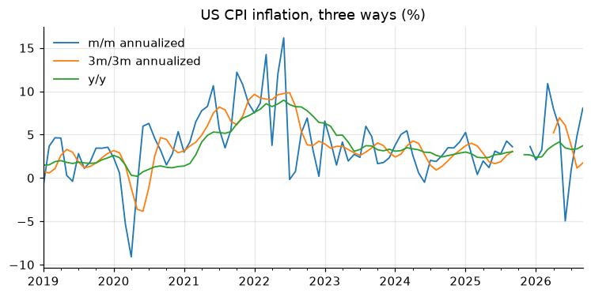

# 7. Rolling windows, smoothing, lags and leads

!!! tip "Quick rules"
    * **Trailing** windows (the default) use only the past: safe for real-time
      indicators and forecasting. **Centered** windows (`center=True`) use the
      future: fine for description, never as a regressor.
    * Set `min_periods` deliberately; the default returns `NaN` until the
      window is full.
    * Report noisy monthly data as **3-month averages** or **3m/3m
      annualized** growth.

```python
import numpy as np
import pandas as pd
import matplotlib.pyplot as plt
from tsmanual import load

payems = load("PAYEMS").asfreq("MS")
cpi = load("CPIAUCSL").asfreq("MS")
brent = load("DCOILBRENTEU").dropna()
```

## Moving averages

```python
jobs = payems.diff()  # monthly change, thousands
ma = pd.DataFrame(
    {
        "monthly change": jobs,
        "3m trailing": jobs.rolling(3).mean(),
        "12m trailing": jobs.rolling(12).mean(),
        "13m centered": jobs.rolling(13, center=True).mean(),
    }
)
print(ma.loc["2025-06":].round(0))
```

The centered average has no value for the last six months: it needs data
that do not exist yet. That is the end-point problem of chapter 6 again.

## Exponential smoothing

An exponentially weighted moving average puts weight $\alpha (1-\alpha)^k$
on the observation $k$ periods ago. Parameterize it by `halflife` (periods
for the weight to halve), `span` or `alpha`.

```python
ewma = jobs.ewm(halflife=3).mean()
print(ewma.tail(3).round(0))
```

## 3m/3m annualized growth

The growth of the last three months' average over the previous three
months, annualized. A standard way to read noisy monthly inflation:

```python
avg3 = cpi.rolling(3).mean()
infl = pd.DataFrame(
    {
        "m/m annualized": 100 * ((cpi / cpi.shift(1)) ** 12 - 1),
        "3m/3m annualized": 100 * ((avg3 / avg3.shift(3)) ** 4 - 1),
        "y/y": 100 * cpi.pct_change(12, fill_method=None),
    }
)
ax = infl.loc["2019":].plot(lw=1.2)
ax.set_title("US CPI inflation, three ways (%)")
# figure: inflation_measures
```



3m/3m reacts faster than y/y and is much less noisy than m/m. The gaps in
late 2025 and 2026 are the missing October 2025 CPI (chapter 2): every
measure whose window touches that month is `NaN`.

## Rolling volatility and correlation

```python
ret = 100 * np.log(brent).diff().dropna()  # daily log returns, %
vol = ret.rolling(21).std() * np.sqrt(252)  # annualized, 1-month window
print(vol.tail(3).round(1))

ret_m = 100 * np.log(load("DCOILBRENTEU").resample("MS").mean()).diff()
ip_m = 100 * np.log(load("INDPRO")).diff()
roll_corr = ret_m.rolling(60).corr(ip_m)  # 5-year rolling correlation
print(roll_corr.dropna().describe().round(2))
```

Use `rolling("30D")` with a time-based window on irregular daily data: it
always covers 30 calendar days, however many observations fall inside.

```python
vol_30d = ret.rolling("30D", min_periods=15).std() * np.sqrt(252)
```

## Rolling regressions

`statsmodels` estimates a regression on every window efficiently. Example:
a rolling Okun's-law coefficient (change in unemployment on GDP growth).

```python
import statsmodels.api as sm
from statsmodels.regression.rolling import RollingOLS

gdp = load("GDPC1").to_period("Q")
u = load("UNRATE").to_period("M").resample("Q").mean()
d = pd.DataFrame({"du": u.diff(), "g": 100 * np.log(gdp).diff()}).dropna()
d = d.loc[:"2019"]  # keep 2020 out of the windows
okun = RollingOLS(d["du"], sm.add_constant(d["g"]), window=40).fit()
print(okun.params["g"].dropna().iloc[::20].round(2))  # every 5 years
```

## Expanding windows

`expanding()` uses all data up to each date: the real-time version of a
full-sample statistic (e.g. a z-score that only uses the past).

```python
growth = 100 * np.log(gdp).diff()
z_realtime = (growth - growth.expanding(40).mean()) / growth.expanding(40).std()
```

## Lags, leads and differences

```python
df = pd.DataFrame({"y": gdp})
df["y_lag1"] = df["y"].shift(1)  # y(t-1)
df["y_lead1"] = df["y"].shift(-1)  # y(t+1)
df["d4"] = df["y"].diff(4)  # y(t) - y(t-4)
df["d_d4"] = df["y"].diff(4).diff()  # change in the 4-quarter difference
print(df.tail(3).round(0))
```

Many lags at once, for a distributed-lag or VAR design matrix (EMT `lagX`):

```python
def lags(s: pd.Series, n: int) -> pd.DataFrame:
    return pd.concat({f"{s.name}_L{k}": s.shift(k) for k in range(1, n + 1)}, axis=1)


X = lags(growth.rename("g"), 4)
print(X.dropna().head(2).round(2))
```

## Pitfalls

* `shift` moves by **rows**, not by time. On an irregular index, call
  `.asfreq()` first, or shift by time with `s.shift(freq="MS")`.
* A rolling statistic on data with `NaN` silently uses fewer observations
  when `min_periods` is lower than the window.
* Centered moving averages and two-sided filters leak future information
  into regressions: forecasts look great in-sample and fail out of sample.
