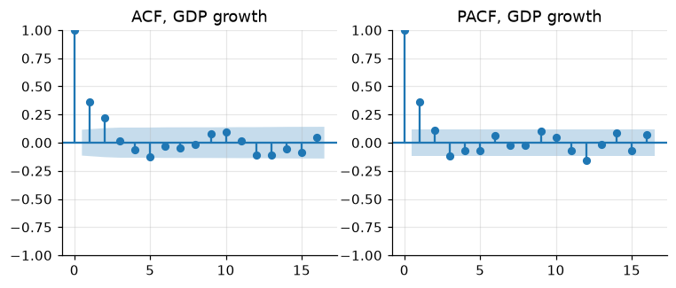

# 9. Diagnostics: stationarity, autocorrelation, outliers

Quick checks before modelling: is the series stationary (or which
transformation makes it so)? How persistent is it? Are there outliers that
will drive the results?

!!! tip "Quick rules"
    * Run **ADF** (null: unit root) and **KPSS** (null: stationary) together.
      Conclusions are strongest when they agree.
    * Include a trend in the test when the series trends (log GDP); omit it
      for growth rates and rates (unemployment).
    * Unit-root tests have low power in short samples and are fooled by
      structural breaks. Use economics as well as p-values.

```python
import warnings

import numpy as np
import pandas as pd
import matplotlib.pyplot as plt
import statsmodels.api as sm
from statsmodels.tsa.stattools import adfuller, kpss, zivot_andrews
from statsmodels.tools.sm_exceptions import InterpolationWarning
from tsmanual import load

y = 100 * np.log(load("GDPC1")).loc[:"2019"]
dy = y.diff().dropna()
u = load("UNRATE").loc[:"2019"]
```

## ADF and KPSS together

```python
def unit_root_table(series: dict[str, pd.Series]) -> pd.DataFrame:
    """ADF and KPSS p-values; `regression` is 'ct' (trend) or 'c' (constant)."""
    rows = {}
    for name, (s, reg) in series.items():
        adf_p = adfuller(s, regression=reg, autolag="AIC", result_object=True).pvalue
        with warnings.catch_warnings():  # KPSS p-values are bounded
            warnings.simplefilter("ignore", InterpolationWarning)
            kpss_p = kpss(s, regression=reg, nlags="auto", result_object=True).pvalue
        verdict = (
            "stationary"
            if adf_p < 0.05 and kpss_p > 0.05
            else "unit root"
            if adf_p > 0.05 and kpss_p < 0.05
            else "unclear"
        )
        rows[name] = {
            "ADF p (H0: unit root)": adf_p,
            "KPSS p (H0: stationary)": kpss_p,
            "verdict": verdict,
        }
    return pd.DataFrame(rows).T.infer_objects()


print(
    unit_root_table(
        {
            "log GDP (trend)": (y, "ct"),
            "GDP growth": (dy, "c"),
            "unemployment rate": (u, "c"),
        }
    ).round(3)
)
```

Log GDP has a unit root, its growth rate is stationary. The unemployment
rate is the typical "unclear" case: both tests reject. It is very persistent
but bounded, a near-unit-root process; treat it as stationary in levels for
most macro work, and check that results survive using its first difference.

KPSS p-values are tabulated only between 0.01 and 0.10; values at those
bounds mean "at most 0.01" or "at least 0.10".

## Structural breaks

A break in the trend makes a stationary series look like a unit root.
Zivot–Andrews tests the unit root against a trend-stationary alternative
with one endogenous break, and estimates the break date.

```python
stat, pval, crit, lags, bp = zivot_andrews(y.to_numpy(), regression="ct", autolag="AIC")
print(f"ZA stat {stat:.2f}, p = {pval:.2f}, break at {y.index[bp]:%Y-%m}")
```

Here the test does not reject: one trend break is not enough to make US log
GDP trend-stationary.

## Autocorrelation

The ACF shows persistence; the PACF suggests the AR order.

```python
fig, axes = plt.subplots(1, 2, figsize=(8, 3))
sm.graphics.tsa.plot_acf(dy, lags=16, ax=axes[0], title="ACF, GDP growth")
sm.graphics.tsa.plot_pacf(
    dy, lags=16, ax=axes[1], title="PACF, GDP growth", method="ywm"
)
# figure: acf_pacf
```



The Ljung–Box test checks whether residuals (or a series) are white noise:

```python
print(sm.stats.acorr_ljungbox(dy, lags=[4, 8], return_df=True).round(4))
```

## Outliers

A robust z-score uses the rolling median and the median absolute deviation
(MAD), which outliers do not drag along.

```python
def robust_outliers(s: pd.Series, window: int = 21, threshold: float = 4.0):
    """Flag points more than `threshold` robust SDs from the rolling median."""
    med = s.rolling(window, center=True, min_periods=window // 2).median()
    mad = (s - med).abs().rolling(window, center=True, min_periods=window // 2).median()
    z = (s - med) / (1.4826 * mad)  # 1.4826 * MAD = SD under normality
    return z.abs() > threshold


claims = load("ICSA")
flags = robust_outliers(np.log(claims))
print(claims[flags].loc["2020"].head())  # the March-April 2020 surge
```

Then decide: **correct** a data error, **dummy** a genuine one-off (strike,
hurricane, lockdown), or **winsorize** when the outliers are noise:

```python
dy_full = 100 * np.log(load("GDPC1")).diff().dropna()
lo, hi = dy_full.quantile([0.01, 0.99])
dy_wins = dy_full.clip(lo, hi)
print(
    dy_full.loc["2020"].round(2).tolist(), "->", dy_wins.loc["2020"].round(2).tolist()
)

covid = pd.Series(0.0, index=dy_full.index)
covid.loc["2020-04-01":"2020-07-01"] = 1.0  # 2020Q2-Q3 dummy for a regression
```

## Pitfalls

* Testing for a unit root in a seasonally unadjusted series without
  seasonal dummies rejects too rarely.
* Running the test on the full sample including 2020 makes many series look
  stationary (a huge mean-reverting spike) or not (a level shift).
* "Fail to reject" is not "accept": ADF cannot tell a unit root from a root
  of 0.95 in 60 years of quarterly data.
