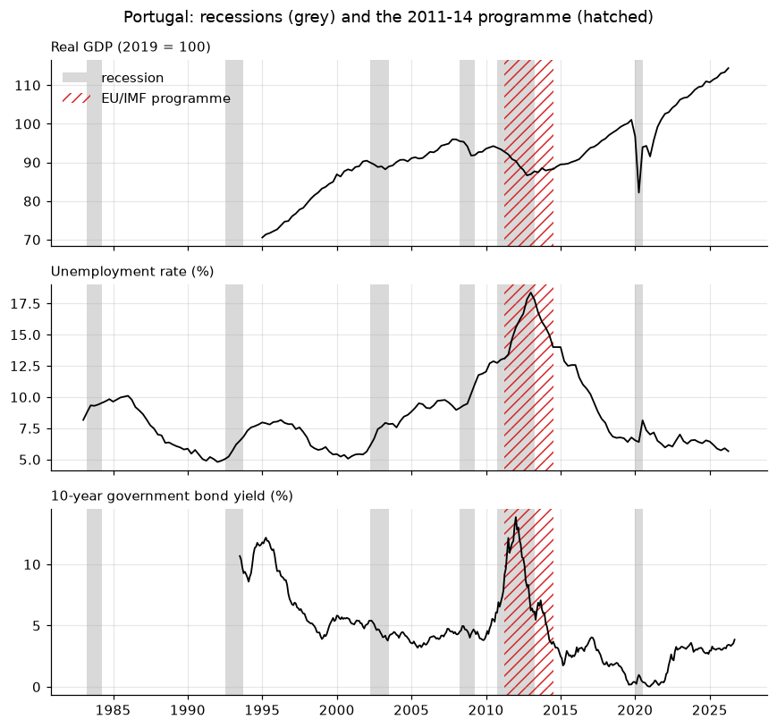
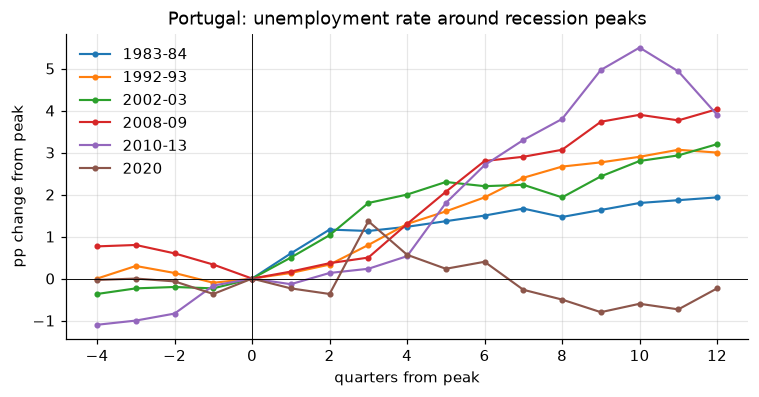
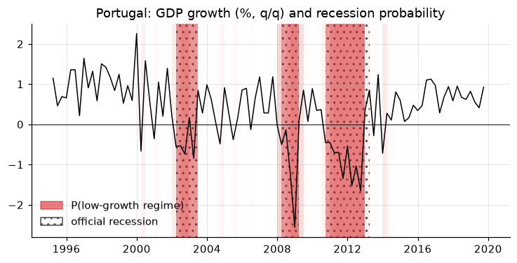

# 10. Crisis dummies and recession bands: Portugal

A recession chronology is a 0/1 series: 1 in the quarters the economy was
in recession. It has two everyday uses: the **grey bands** behind a chart,
and **dummy variables** in a regression. This chapter does both with a
quarterly recession indicator for Portugal (1980–2020) and Portuguese GDP,
unemployment and the 10-year government bond yield.

!!! tip "Quick rules"
    * Shade the **whole period**: a band for 2008Q2 runs from 1 April to
      30 June, not from one tick mark to the next.
    * Beyond the end of the chronology the state is **unknown**, not
      "expansion". Keep it `NaN`; never `fillna(0)` blindly.
    * Choose the dummy type to match the event: **pulse** for a one-off,
      **step** for a permanent shift, a **slope dummy** (interaction) when the
      relationship itself changes in recessions.
    * Do not regress GDP on a recession dummy built from GDP and call it a
      finding: the dummy is defined by the outcome.

```python
import numpy as np
import pandas as pd
import matplotlib.pyplot as plt
from matplotlib.patches import Patch
import statsmodels.api as sm
import statsmodels.formula.api as smf
from tsmanual import DATA_DIR, load

gdp = load("CLVMNACSCAB1GQPT").to_period("Q")  # real GDP, chained 2010 EUR mn
u = load("LRHUTTTTPTQ156S").to_period("Q")  # unemployment rate, %
y10 = load("IRLTLT01PTM156N").to_period("M")  # 10-year bond yield, %, monthly
```

## Reading the chronology

The file is tab-separated with day-first dates (`01/04/1980` is 1 April).
Parsed without a format, pandas reads it month-first, as 4 January:

```python
raw = pd.read_csv(DATA_DIR / "pt_recessions.txt", sep="\t")
print(raw.head(3))
print(pd.to_datetime(raw["data"].head(3)).tolist())  # wrong: Jan 1, 4, 7

dates = pd.to_datetime(raw["data"], format="%d/%m/%Y")  # right
rec = pd.Series(
    raw["indicador"].to_numpy(), name="rec", index=pd.PeriodIndex(dates, freq="Q")
)
print(rec.index[[0, -1]], rec.sum(), "recession quarters")
```

## From dummy to episodes and back

A run of ones is one episode. Converting to a table of start and end dates
makes the chronology readable, and the reverse builds a dummy from a list of
dates (from a paper, a press release, a programme calendar).

```python
def episodes(dummy: pd.Series) -> pd.DataFrame:
    """One row per run of ones: first quarter, last quarter, length."""
    d = dummy.fillna(0).astype(int)
    starts = d.index[(d == 1) & (d.shift(1, fill_value=0) == 0)]
    ends = d.index[(d == 1) & (d.shift(-1, fill_value=0) == 0)]
    return pd.DataFrame(
        {
            "start": starts,
            "end": ends,
            "length": [(e - s).n + 1 for s, e in zip(starts, ends)],
            "peak": starts - 1,  # last quarter before the fall
        }
    )


def dummy_from_episodes(index: pd.PeriodIndex, spans) -> pd.Series:
    """0/1 series on `index`, 1 inside each (start, end) span, inclusive."""
    out = pd.Series(0, index=index)
    for start, end in spans:
        out.loc[start:end] = 1
    return out


ep = episodes(rec)
ep["name"] = [
    f"{s.year}-{str(e.year)[2:]}" if e.year != s.year else str(s.year)
    for s, e in zip(ep["start"], ep["end"])
]
print(ep.to_string(index=False))

# The EU/IMF adjustment programme, May 2011 to May 2014
troika = dummy_from_episodes(rec.index.union(gdp.index), [("2011Q2", "2014Q2")])
```

## Grey bands

One helper for every chart. It converts each run of ones into a span from
the **start of its first period to the end of its last**, so the same
quarterly dummy shades a monthly or daily chart correctly.

```python
def shade(ax, dummy: pd.Series, **style) -> None:
    """Shade the periods where `dummy` == 1 (PeriodIndex or DatetimeIndex).

    `style` goes to `ax.axvspan`; the default is a plain grey band. For a
    hatched band pass e.g. fc="none", ec="C3", hatch="///".
    """
    if not {"color", "fc", "facecolor"} & style.keys():
        style["color"] = "0.85"
    style = {"lw": 0, "zorder": 0, **style}
    for _, row in episodes(dummy).iterrows():
        start, end = row["start"], row["end"]
        if isinstance(start, pd.Period):
            start, end = start.start_time, end.end_time
        ax.axvspan(start, end, **style)
        style.pop("label", None)  # label the first band only


fig, axes = plt.subplots(3, 1, figsize=(8, 7.5), sharex=True)
panels = [
    (100 * gdp / gdp["2019"].mean(), "Real GDP (2019 = 100)"),
    (u, "Unemployment rate (%)"),
    (y10, "10-year government bond yield (%)"),
]
for ax, (s, title) in zip(axes, panels):
    ax.plot(s.index.to_timestamp(), s.to_numpy(), color="k", lw=1.2)
    shade(ax, rec, label="recession")
    shade(ax, troika, fc="none", ec="C3", hatch="///", label="EU/IMF programme")
    ax.set_title(title, loc="left", fontsize=10)
axes[0].legend(loc="upper left")
fig.suptitle("Portugal: recessions (grey) and the 2011-14 programme (hatched)")
fig.tight_layout()
# figure: pt_bands
```



Variations: one color per crisis type, `alpha` for uncertainty (the last
section shades by probability), or `ax.axvline` at each peak and trough when
bands would hide the data.

## Recession dummies in regressions

The simplest use: average growth and unemployment change in recessions vs
expansions. Use HAC standard errors, since recession quarters cluster.

```python
g = (100 * np.log(gdp).diff()).rename("g")  # q/q growth, %
du = u.diff().rename("du")  # change in unemployment, pp
df = pd.concat([g, du, rec], axis=1).dropna()  # 1995Q2-2020Q4, where all exist
print(df.groupby("rec")[["g", "du"]].mean().round(2))

m = smf.ols("du ~ rec", data=df).fit(cov_type="HAC", cov_kwds={"maxlags": 4})
print(m.summary().tables[1])
```

`df` ends in 2020Q4 because the chronology does: `dropna` keeps only
quarters where the state is known. That is the correct treatment.

### Episode dummies

One dummy per crisis compares episodes. `pd.get_dummies` builds the matrix
from an episode label:

```python
label = pd.Series(np.nan, index=rec.index, dtype=object)
for _, row in ep.iterrows():
    label.loc[row["start"] : row["end"]] = row["name"]
ep_dummies = pd.get_dummies(label, dtype=float).reindex(rec.index, fill_value=0.0)
print(ep_dummies.sum())  # quarters per episode

cum = pd.DataFrame(
    {
        "GDP change (log %)": g.groupby(label).sum(),
        "unemployment change (pp)": du.groupby(label).sum(),
        "quarters": label.value_counts(),
    }
)
print(cum.loc[ep["name"]].round(1))
```

GDP starts in 1995, so the two earlier recessions show only the unemployment
response. The 2020 recession is the deepest in output and the only one in
which unemployment *fell*: job-retention schemes (*lay-off simplificado*)
and people leaving the labour force absorbed the shock.

### Slope dummies: does Okun's law change in recessions?

An interaction `g:rec` lets the slope differ between regimes. Estimated on
1995–2019, since 2020 breaks the link (see above):

```python
okun = smf.ols("du ~ g * rec", data=df.loc[:"2019"]).fit(
    cov_type="HAC", cov_kwds={"maxlags": 4}
)
print(okun.params.round(3))
print(
    "slope in expansions:",
    okun.params["g"].round(3),
    "| in recessions:",
    (okun.params["g"] + okun.params["g:rec"]).round(3),
    "| p-value of the difference:",
    okun.pvalues["g:rec"].round(3),
)
```

In Portugal, Okun's law is a recession phenomenon: in expansions, faster
growth barely moves unemployment; in recessions, each point of lost growth
adds about a quarter point to the unemployment rate.

## Event study: crises side by side

Align each episode on its peak (the last quarter before the recession) and
plot the change from the peak. Leads and lags of the dummy are just the
quarters $t-4, \dots, t+12$ around each peak.

```python
def around(s: pd.Series, peaks, before: int = 4, after: int = 12) -> pd.DataFrame:
    """Column per peak: s(t+k) - s(peak), for k = -before..after."""
    out = {}
    for p in peaks:
        k = range(-before, after + 1)
        out[p] = pd.Series(
            [s.get(p + j, np.nan) - s.get(p, np.nan) for j in k], index=list(k)
        )
    return pd.DataFrame(out)


paths = around(u, ep["peak"])
paths.columns = ep["name"].to_list()
ax = paths.plot(marker=".", lw=1.4)
ax.axvline(0, color="k", lw=0.6)
ax.axhline(0, color="k", lw=0.6)
ax.set_xlabel("quarters from peak")
ax.set_ylabel("pp change from peak")
ax.set_title("Portugal: unemployment rate around recession peaks")
# figure: pt_event_study
```



The 2010–13 recession stands out: unemployment rose 5.5 pp in ten quarters,
twice as much as in any earlier episode. In 2020 it barely moved.

## Dummy types for outliers and breaks

| Type | Shape | Use for |
|---|---|---|
| pulse (additive outlier) | 0 0 1 0 0 | a one-quarter shock (strike, lockdown quarter) |
| step (level shift) | 0 0 1 1 1 | a permanent change in level (redefinition, euro entry) |
| ramp | 0 0 1 2 3 | a change in trend growth |
| temporary change | 0 0 1 .7 .49 | a shock that decays geometrically |

```python
def pulse(index, at):
    return pd.Series((index == pd.Period(at, index.freq)).astype(float), index=index)


def step(index, at):
    return pd.Series((index >= pd.Period(at, index.freq)).astype(float), index=index)


def ramp(index, at):
    return step(index, at).cumsum()


def temporary_change(index, at, delta=0.7):
    s = step(index, at)
    return (delta ** (s.cumsum() - 1)).where(s == 1, 0.0)
```

Two pulse dummies for the 2020 lockdown and reopening transform an AR(1) for
Portuguese GDP growth:

```python
gg = g.dropna()
covid = pd.concat(
    {"2020Q2": pulse(gg.index, "2020Q2"), "2020Q3": pulse(gg.index, "2020Q3")}, axis=1
)
fits = {
    "no dummies": sm.tsa.SARIMAX(gg, order=(1, 0, 0), trend="c").fit(disp=False),
    "COVID pulses": sm.tsa.SARIMAX(gg, exog=covid, order=(1, 0, 0), trend="c").fit(
        disp=False
    ),
}
print(pd.DataFrame({k: r.params for k, r in fits.items()}).round(3))
```

Without the dummies, the two 2020 observations dominate: persistence turns
negative (a crash followed by a rebound looks like mean reversion) and the
residual variance is four times larger.

## Recession probabilities as bands

Hamilton's (1989) Markov-switching model lets GDP growth switch between a
high-mean and a low-mean regime and estimates the probability of being in
the low one each quarter. Shading with that probability as the opacity
compares a model-based chronology with the official one. Estimated on
1995–2019, to keep 2020 from becoming a regime of its own:

```python
y_ms = gg.loc[:"2019"].to_timestamp().asfreq("QS")
ms = sm.tsa.MarkovRegression(y_ms, k_regimes=2).fit(disp=False, search_reps=20)
low = int(np.argmin([ms.params["const[0]"], ms.params["const[1]"]]))
prob = ms.smoothed_marginal_probabilities[low]
prob.index = prob.index.to_period("Q")
print(ms.params.round(3))

both = pd.concat([prob.rename("p"), rec], axis=1).dropna()
concordance = ((both["p"] > 0.5).astype(int) == both["rec"]).mean()
print(f"concordance with the official dating: {concordance:.2f}")
```

The concordance index (Harding and Pagan, 2002) is the share of quarters in
which the two chronologies agree.

```python
fig, ax = plt.subplots()
for q, p in prob.items():  # one band per quarter, opacity = p
    ax.axvspan(q.start_time, q.end_time, color="C3", alpha=0.6 * p, lw=0)
growth = gg.loc[:"2019"]
ax.plot(growth.index.to_timestamp(), growth.to_numpy(), color="k", lw=1)
shade(ax, rec.loc["1995":"2019"], fc="none", ec="0.3", hatch="..")
ax.axhline(0, color="k", lw=0.6)
ax.legend(
    handles=[
        Patch(color="C3", alpha=0.6, label="P(low-growth regime)"),
        Patch(fc="none", hatch="..", ec="0.3", label="official recession"),
    ],
    loc="lower left",
)
ax.set_title("Portugal: GDP growth (%, q/q) and recession probability")
# figure: pt_ms_bands
```



## Pitfalls

* **Chronologies end.** This one stops in 2020Q4. Reindexing to a longer
  sample creates `NaN` after that date; keep them, or extend the chronology
  explicitly.
* **The dummy trap.** A constant plus a recession dummy plus an expansion
  dummy is perfectly collinear. Use one of the two.
* **Timing conventions differ.** Some chronologies mark the peak quarter as
  the first recession quarter, others mark the quarter after it. Check before
  merging two sources or computing durations.
* **Monthly charts, quarterly dummies.** Do not `asfreq` the dummy to monthly
  with `ffill` and then shade month by month: use period start and end times,
  as `shade` does.
