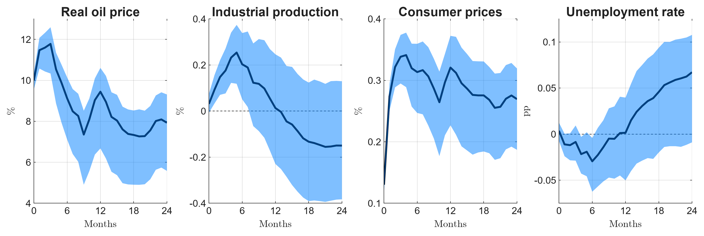
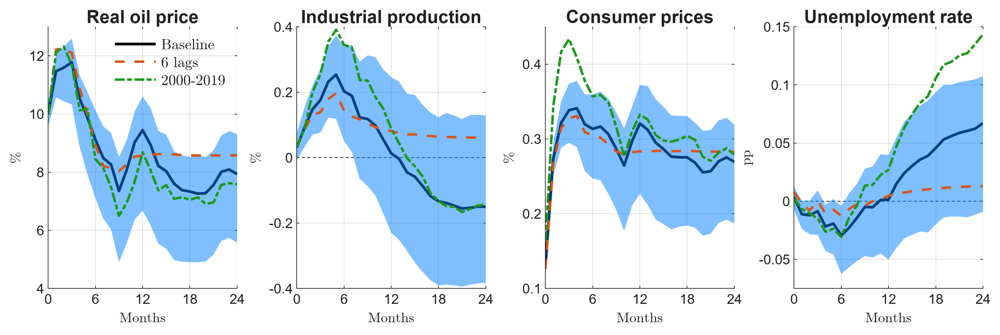
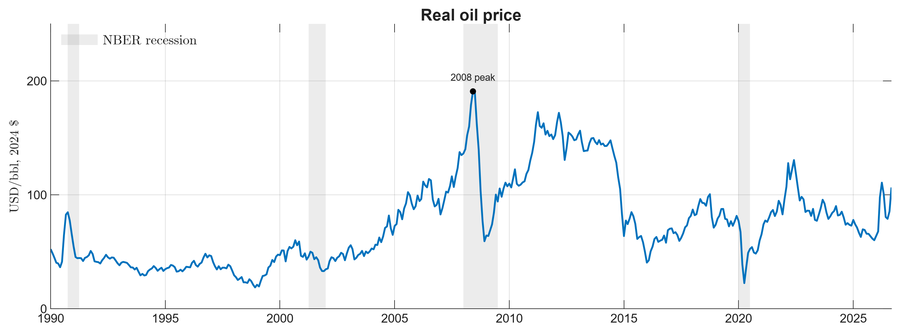
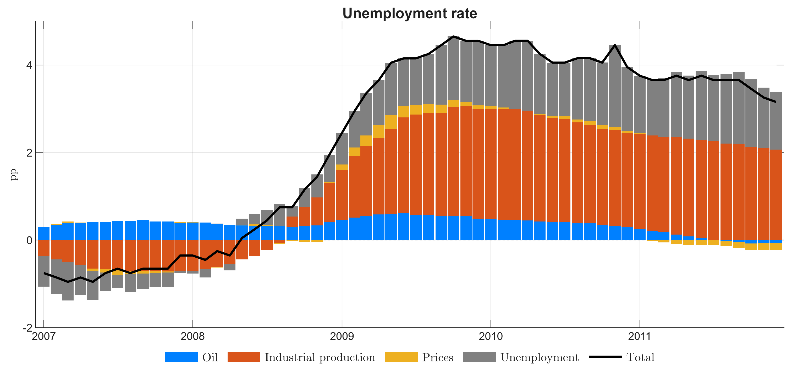

# 11. Paper-quality figures: impulse responses and decompositions

Figures in a paper follow different rules from exploratory plots: they are
read in print, in grey, at a small size, next to a caption. This chapter
draws the standard figures of an SVAR paper with
[housestyle](https://github.com/hmorao95/housestyle), a small package that
reproduces the MATLAB house style of the mshipping papers in matplotlib, so
Python and MATLAB figures can sit side by side in one paper.

!!! tip "Quick rules"
    * Point estimate **black**, band **translucent blue over it**, dashed zero
      line only when zero is in range.
    * Tell series apart by **line style as well as color** (solid, dashed,
      dash-dot): figures must survive grey print and colorblind readers.
      More than four series: use small multiples.
    * **No overall title**: the LaTeX caption explains the figure. Panel
      titles are short, plain and without units; every panel has a y label
      with units.
    * One legend per figure. Export at **300 dpi**, cropped to the content.
    * Keep the computation and the drawing apart: write the plotted arrays to
      a tidy CSV, then draw from it with one script per figure.

```python
import numpy as np
import pandas as pd
import statsmodels.api as sm
import housestyle as hs
from tsmanual import load
```

## The model: a small oil-shock SVAR

Monthly US data, 1990–2019: the real oil price, industrial production and
CPI in log differences × 100, and the unemployment rate in levels. The oil
price is ordered first, so an oil shock can move everything else on impact
but nothing else moves the oil price within the month (a recursive,
Cholesky identification). Twelve lags.

```python
oil = load("DCOILBRENTEU").resample("MS").mean()  # daily -> monthly mean
cpi, ip, u = load("CPIAUCSL"), load("INDPRO"), load("UNRATE")
data = (
    pd.DataFrame(
        {
            "oil": 100 * np.log(oil / cpi).diff(),  # real oil price growth
            "ip": 100 * np.log(ip).diff(),
            "cpi": 100 * np.log(cpi).diff(),
            "u": u,
        }
    )
    .loc["1990":"2019"]
    .asfreq("MS")
)

var = sm.tsa.VAR(data).fit(12)
H = 24
irf = var.irf(H)
```

Responses of variables in growth rates are **cumulated** to give the effect
on the level; the unemployment rate is already a level. The shock is scaled
to raise the real oil price by 10% on impact, a more readable unit than "one
standard deviation".

```python
cumulate = np.array([True, True, True, False])  # oil, ip, cpi | u
point = np.where(cumulate, irf.orth_cum_effects[:, :, 0], irf.orth_irfs[:, :, 0])
scale = 10 / point[0, 0]

rng = np.random.default_rng(0)  # 68% Monte Carlo bands
lo_c, hi_c = irf.cum_errband_mc(orth=True, repl=500, signif=0.32, rng=rng)
lo_l, hi_l = irf.errband_mc(orth=True, repl=500, signif=0.32, rng=rng)
lo = np.where(cumulate, lo_c[:, :, 0], lo_l[:, :, 0])
hi = np.where(cumulate, hi_c[:, :, 0], hi_l[:, :, 0])

med, lo, hi = point * scale, lo * scale, hi * scale
print(
    pd.DataFrame(med[[0, 6, 12, 24]], index=[0, 6, 12, 24], columns=data.columns).round(
        2
    )
)
```

A 10% oil price increase raises the CPI by about 0.3% within six months
and leaves real activity almost unchanged: industrial production moves by a
fraction of a percent, unemployment by hundredths of a point. That is the
familiar finding that oil price *changes* mix supply and demand shocks; a
paper would separate them (Kilian, 2009).

## Impulse responses in a grid

`hs.figure(rows, cols)` sets up the MATLAB-sized grid; `hs.irf` draws a
panel: black median, band over it, zero line, labels. The horizon starts at
0 (impact), so text quoting h = 0, 6, 12 matches the axis.

```python
names = [
    "Real oil price",
    "Industrial production",
    "Consumer prices",
    "Unemployment rate",
]
units = ["%", "%", "%", "pp"]
h = np.arange(H + 1)

fig, axes = hs.figure(1, 4)
for k, ax in enumerate(axes):
    ax.set_xticks(range(0, H + 1, 6))
    hs.irf(ax, h, med[:, k], lo[:, k], hi[:, k], names[k], units[k], "Months")
# figure: hs_irf_grid
```



In a paper the script ends with the export, which writes a 300 dpi PNG (or a
PDF, by suffix) cropped to the content:

```py
hs.outdir("figures")  # once per script
hs.export(fig, "irf_oil_baseline")
```

## Comparing specifications

Robustness figures overlay alternatives on the baseline and its band. Draw
the baseline, then the band, then the alternatives, then `hs.finish` for
labels and the zero line; the legend goes in one panel.

```python
def point_irf(data, lags):
    """Point responses to a 10% oil shock, cumulated like the baseline."""
    r = sm.tsa.VAR(data).fit(lags).irf(H)
    p = np.where(cumulate, r.orth_cum_effects[:, :, 0], r.orth_irfs[:, :, 0])
    return p * 10 / p[0, 0]


alternatives = {
    "6 lags": point_irf(data, 6),
    "2000-2019": point_irf(data.loc["2000":], 12),
}

fig, axes = hs.figure(1, 4)
for k, ax in enumerate(axes):
    h1 = hs.line(ax, h, med[:, k], 1)  # black solid
    hs.band(ax, h, lo[:, k], hi[:, k])
    h2 = hs.line(ax, h, alternatives["6 lags"][:, k], 2)  # orange dashed
    h3 = hs.line(ax, h, alternatives["2000-2019"][:, k], 3)  # green dash-dot
    ax.set_xlim(0, H)
    ax.set_xticks(range(0, H + 1, 6))
    hs.finish(ax, names[k], units[k], "Months")
hs.legend(axes[0], [h1, h2, h3], ["Baseline", "6 lags", "2000-2019"], loc="upper right")
# figure: hs_compare
```



## Time series with shaded episodes and events

One observed series is drawn in the MATLAB blue (`hs.line(..., "data")`);
`hs.shade` adds grey episodes behind the data and `hs.event` labels a point.
Here, the real oil price with NBER recessions:

```python
real_oil = (oil / cpi * cpi["2024"].mean()).loc["1990":].dropna()
rec = load("USRECQ").to_period("Q").loc["1990":]
starts = rec.index[(rec == 1) & (rec.shift(1, fill_value=0) == 0)]
ends = rec.index[(rec == 1) & (rec.shift(-1, fill_value=0) == 0)]

fig, ax = hs.figure(1, 1, 380)
hs.line(ax, real_oil.index, real_oil.to_numpy(), "data")
for s, e in zip(starts, ends):
    shade = hs.shade(ax, s.start_time, e.end_time, label="Recession")
ax.set_xlim(real_oil.index[0], real_oil.index[-1])
ax.set_ylim(0, 250)
peak = real_oil.loc["2008"].idxmax()
hs.event(ax, peak, real_oil[peak], "2008 peak")
hs.finish(ax, "Real oil price", "USD/bbl, 2024 \\$")
hs.legend(ax, [shade], ["NBER recession"], loc="upper left")
# figure: hs_timeseries
```



## Historical decomposition

A historical decomposition splits each variable, period by period, into the
contribution of each structural shock plus a deterministic part (constant
and initial conditions). With residuals $u_t$, the Cholesky factor $P$ of
their covariance and the orthogonalized MA coefficients $\Theta_j$, the
shocks are $\varepsilon_t = P^{-1}u_t$ and shock $k$ contributes
$\sum_{j=0}^{t}\Theta_j[i,k]\,\varepsilon_{t-j,k}$ to variable $i$ at $t$.

```python
eps = var.resid.to_numpy() @ np.linalg.inv(np.linalg.cholesky(var.sigma_u)).T
T, n = eps.shape
theta = var.orth_ma_rep(maxn=T - 1)  # (T, n, n)
contrib = np.zeros((T, n, n))  # time, variable, shock
for t in range(T):
    contrib[t] = np.einsum("jik,jk->ik", theta[: t + 1], eps[t::-1])

dates = var.resid.index
actual = data.loc[dates].to_numpy()
deterministic = actual - contrib.sum(axis=2)
print("adds up:", np.allclose(deterministic + contrib.sum(axis=2), actual))
```

The decomposition of the unemployment rate around the Great Recession, as
stacked bars with the total (actual minus deterministic part) on top:

```python
window = (dates >= "2007-01-01") & (dates <= "2011-12-01")
x = dates[window].to_numpy()
Y = contrib[window, 3, :]  # unemployment, all shocks
total = Y.sum(axis=1)

fig, ax = hs.figure(1, 1, 460)
bars = hs.bars(ax, x, Y)
h_total = hs.line(ax, x, total, 1)
ax.set_xlim(x[0] - np.timedelta64(20, "D"), x[-1] + np.timedelta64(20, "D"))
hs.finish(ax, "Unemployment rate", "pp")
hs.legend(
    ax,
    [*bars, h_total],
    ["Oil", "Industrial production", "Prices", "Unemployment", "Total"],
    outside="south",
)
# figure: hs_decomposition
```



Of the 4.5-point rise in unemployment in 2008–09, the model attributes most
to industrial production shocks and to unemployment's own shocks; oil shocks
account for about half a point, consistent with the small impulse responses
above.

## Without housestyle

The essentials take a few lines of plain matplotlib, if you prefer no
dependency:

```py
import matplotlib.pyplot as plt

plt.rcParams.update(
    {
        "axes.grid": True,
        "grid.alpha": 0.15,
        "xtick.direction": "in",
        "ytick.direction": "in",
        "xtick.top": True,
        "ytick.right": True,
        "axes.titleweight": "bold",
        "mathtext.fontset": "cm",
        "savefig.dpi": 300,
    }
)
fig, ax = plt.subplots()
ax.plot(h, med[:, 0], color="k", lw=2)
ax.fill_between(h, lo[:, 0], hi[:, 0], color=(0, 0.5, 1), alpha=0.5, lw=0)
ax.axhline(0, color="k", ls="--", lw=0.5, zorder=0)
fig.savefig("irf.png", bbox_inches="tight", facecolor="white")
```

## Pitfalls

* **Cumulate the right variables.** Responses of variables in differences
  are cumulated to get levels; cumulating a variable already in levels (the
  unemployment rate) produces nonsense.
* **State the shock size and the band.** "68% bands, shock normalized to a
  10% oil price increase" belongs in the caption.
* **Same axes across a comparison**, different axes across variables:
  comparing specifications needs identical y-limits within a panel, not
  across panels.
* **Bands are about the estimate, not the identification.** A tight band
  around a recursive SVAR says nothing about whether the ordering is right.
